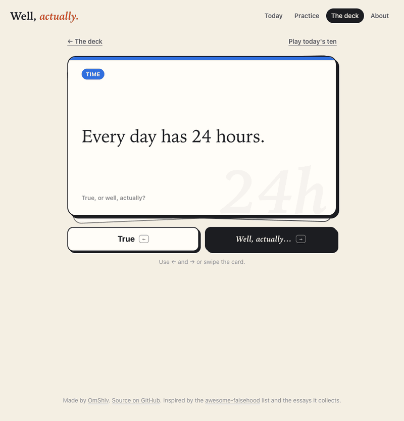

<h1 align="center">Well, actually.</h1>

<p align="center"><b>A daily card game about the things every programmer believes.<br>Every card proves itself in your browser.</b></p>

<p align="center"><a href="https://omshiv.github.io/well-actually/"><b>Play today's ten →</b></a></p>

<p align="center">
  
</p>

Every day has 24 hours. Everyone has a first name and a last name. `0.1 + 0.2 === 0.3`. Postal codes are numbers.

Each of these is almost true, which is what makes them dangerous. They pass code review, they pass your tests, and then a customer in Nepal, a German spreadsheet, or a Sunday in March proves them wrong in production.

**Well, actually** deals you ten of these beliefs a day. For each one, decide whether it's true or whether it deserves a "well, actually". Then turn the card over to see the answer, why it matters, and the proof.

## Every card proves itself

Most cards end with a few lines of JavaScript that run right there on the card, in your browser:

```js
const ny = new Intl.DateTimeFormat('en-US', {
  timeZone: 'America/New_York',
  dateStyle: 'medium',
  timeStyle: 'long',
});
const day = 24 * 60 * 60 * 1000;

const march8 = Date.UTC(2026, 2, 8, 5);   // midnight in New York
console.log(ny.format(march8));           // Mar 8, 2026, 12:00:00 AM EST
console.log(ny.format(march8 + day));     // Mar 9, 2026, 1:00:00 AM EDT
```

Twenty-four hours after midnight, it's 1 AM: that day only had 23 hours. Press **Edit** on any proof to change the code and run it again. Swap the emoji in the `length` card for a flag, move the date in the leap year card, try your own time zone. Don't take the card's word for it.

## What's in the deck

61 cards in seven categories. Most claims are false, but not all of them, so you can't just answer "well, actually" every time.

| Category | Cards | For example |
|---|---|---|
| Time | 16 | Every day has 24 hours. A Unix timestamp fits in 32 bits. January 1 is always in week 1. |
| Numbers | 13 | `(1.005).toFixed(2)` is "1.01". `Math.round(-2.5)` is -3. `typeof NaN` is "number". |
| Text | 10 | Two strings that look the same are equal. Uppercasing doesn't change a string's length. |
| The web | 7 | Phone numbers can be stored as integers. URLs are case-insensitive. |
| Names | 6 | Everyone has a family name. The family name comes last. |
| Places | 5 | Postal codes are numbers. Each country has one time zone. |
| Money | 4 | Every currency has two decimal places. The currency symbol goes before the amount. |

Every card links to its source: the [awesome-falsehood](https://github.com/kdeldycke/awesome-falsehood) list, the essays it collects, specs, and MDN.

## The daily deck

Everyone on the same date gets the same ten cards, chosen so that no category takes more than three, one to three cards are actually true, and no card gives away another. A new deck starts at midnight in your time zone, so two people can be playing different decks at the same moment. There's a card about that.

Your score, answers, and streak stay in your browser. There are no accounts, no analytics, and the page loads nothing but its own files.

You can also **practice** one category at a time, or browse **the deck** with every answer and proof.

## Add a card

Cards live in [`src/cards.js`](src/cards.js). A card looks like this:

```js
{
  id: 'adding-a-month',
  category: 'time',
  claim: 'Adding one month to a date lands on the same day next month.',
  answer: false,
  truth: 'January 31 plus a month is March 3 in JavaScript.',
  explain: "February 31 doesn't exist, so `setMonth()` rolls the extra days into March. ...",
  proof: raw`const date = new Date(2026, 0, 31);   // January 31
date.setMonth(date.getMonth() + 1);
console.log(date.toDateString());`,
  source: { label: 'setMonth() on MDN', url: 'https://developer.mozilla.org/...' },
}
```

The test suite runs every proof, compares its output with [`test/proofs.snapshot.json`](test/proofs.snapshot.json), and checks that the output is the same in four time zones and three locales, so a proof can't depend on where it runs. After adding a card, read its output carefully, then refresh the snapshot:

```sh
npm test
node test/print-proofs.js > test/proofs.snapshot.json
```

Cards without a runnable proof (most names and places) list real examples instead.

## Run it locally

There's no build step and no dependencies. Serve the folder with any static server:

```sh
npm start          # python3 -m http.server 8080
npm test           # Node.js 20 or later
```

## Credits

The "falsehoods programmers believe" genre started with Patrick McKenzie's [Falsehoods Programmers Believe About Names](https://www.kalzumeus.com/2010/06/17/falsehoods-programmers-believe-about-names/) in 2010 and grew into Kevin Deldycke's [awesome-falsehood](https://github.com/kdeldycke/awesome-falsehood) list. This game wouldn't exist without them.

## License

[MIT](LICENSE)
